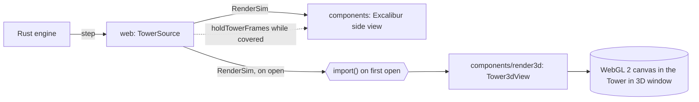

# Architecture

## Executive Summary

The Tower in 3D view is a second, separate renderer that draws the player's
tower in 3D inside its own window. It reads the same render model
(`RenderSim`) the side view reads, so it holds no rule and never calls the
engine. The renderer lives in Verticopolis/components as its own entry point
(`@verticopolis/components/render3d/*`), the only code that imports the 3D
library. Verticopolis/web owns the window, the menu entry, the lazy load and
the offline caching. When the window is closed nothing of it is downloaded,
parsed or run.



### Project Initialization

No starter template: this extends two existing repositories. Setup is the
usual `npm ci` in each. The only new dependency is the 3D library in
Verticopolis/components.

## Decision Summary

| # | Category | Decision | Version | Affects | Rationale |
| --- | --- | --- | --- | --- | --- |
| D1 | 3D renderer | three.js, `WebGLRenderer` (WebGL 2) only | `three` 0.187.0 (latest, published 2026-10-30, checked on npm 2026-11-25), MIT | Epic 1, 2 | Smallest mature option; tree-shakes; MIT is on the allowlist. Babylon.js is several times larger; a hand-written WebGL renderer is months of work. WebGPU is out of v1 (phone coverage). |
| D2 | Where it lives | New `src/render3d/` in components, exported as `./render3d/*`; `three` pinned exactly as a dependency of components | n/a | Epic 2 | All reusable rendering lives in components (standing rule); a separate subpath keeps three.js out of every other import. |
| D3 | Input data | `RenderSim` only, read through a `() => RenderSim` callback each frame | n/a | Epic 2, 3 | Same data as the side view; no engine import (components rule) and no new render-model field for v1. |
| D4 | Loading | Dynamic `import()` from the web window opener; Vite emits one `tower3d-*` chunk (view plus three.js) | Vite 7.3 (current pin) | Epic 3 | Zero bytes until opened. |
| D5 | Install and offline | `tower3d-*` excluded from the Workbox precache (`globIgnores`); a CacheFirst runtime route caches it on first open | Workbox via the current PWA plugin | Epic 3 | Keeps the install budget unchanged; offline from the second open. |
| D6 | Room geometry | One merged geometry per band of 8 floors, vertex-colored, rebuilt only when a floor in the band changes | n/a | Epic 2 (whole rebuild), Epic 3 (incremental) | Bounds draw calls (a 110-floor tower is 14 bands). The mockup's one-mesh-per-box drew 1,492 calls for 17 floors. |
| D7 | People and cars | `InstancedMesh`: people capped at 2,000 (nearest the camera), cars one instanced mesh per elevator kind | n/a | Epic 2 | One draw call each; matrices updated per frame within the hot-path budget. |
| D8 | Quality tiers | Low, Medium, High, chosen at open from the device, stepped down automatically when frames run long | n/a | Epic 2 | Phones get no real-time shadows; desktops get static shadows. |
| D9 | Frame loop | The view runs its own `requestAnimationFrame` loop only while the window is open and visible; it skips drawing when nothing moved | n/a | Epic 2, 3 | No cost when hidden or paused. |
| D10 | Side view while covered | Web calls the existing `holdTowerFrames` when the 3D window is maximized or full screen | n/a | Epic 3 | Reuses the screen saver's mechanism; one renderer draws at a time. |
| D11 | Teardown | On close: dispose geometries, materials, textures, then `renderer.dispose()` and `forceContextLoss()` | n/a | Epic 2, 3 | Only one live 3D context (iOS limit, memory). |
| D12 | Art source | All 3D looks are generated in code from one `looks3d` table keyed by `FacilityKind` | n/a | Epic 2 | No asset files; the type system and a unit test force a look for every kind. |
| D13 | Mode gating | None: the menu item shows in every tower (party re-run 2026-11-25, 8 to 3, any tower); components does not know about modes | n/a | Epic 2 | Keeps the renderer generic and removes a branch, a grayed item and its test. |

Deferred: tap-to-inspect picking (out of scope v1), WebGPU, a flyover camera
path.

## Project Structure

```
components/
  src/render3d/
    Tower3dView.ts        the public class: mount, update loop, dispose
    looks3d.ts            Record<FacilityKind, Look3d>: boxes, colors, night glow
    bandGeometry.ts       builds one merged geometry for a band of floors
    floorDigest.ts        per-floor change digest from RenderTower
    crowd3d.ts            sampled, instanced people
    transport3d.ts        shafts, cars, stairs, escalators, sky bridges
    lot3d.ts              ground cut, street, trees, facade, roof
    sky3d.ts              time of day and weather lighting
    quality.ts            tier choice and automatic step-down
    camera3d.ts           orbit, zoom, pan, keyboard, reduced motion, limits
    *.test.ts             unit tests with the catalog fixtures and fakes
  gallery/                a "Tower in 3D" gallery page with a fixture tower
web/
  src/ui/tower3dWindow.ts  menu entry, window, lazy import, picture, summary
  src/ui/tower3dWindow.test.ts
  vite.config.ts           tower3d chunk name, globIgnores, runtime route
  scripts/verify-precache.ts  fails the build if a tower3d chunk is precached
  help-site/...            "Tower in 3D" help page
```

## Epic to Architecture Mapping

| Epic | Repository | Main parts |
| --- | --- | --- |
| 1 Prototype and gate | components and web (draft branches, Vercel preview) | `Tower3dView`, `bandGeometry`, `crowd3d`, a measurement page |
| 2 See my tower in 3D | components (2.1-2.5), then web (2.6-2.10) | `Tower3dView`, `looks3d`, `bandGeometry`, `transport3d`, `camera3d`, `quality`, `lot3d`; `tower3dWindow.ts`, Vite and Workbox config |
| 3 A living tower | components (3.1-3.3), then web (3.4-3.6) | `crowd3d`, `sky3d`, `floorDigest`; picture, help, analytics, gate run |

## Technology Stack Details

### Core Technologies

- three.js 0.187.0 (MIT), WebGL 2 renderer. Measured for a scene like the
  mockup with orbit controls: 563 KB raw, 139 KB gzipped (esbuild, minified,
  2026-11-25). Camera input is written in `camera3d.ts` instead of importing
  the example `OrbitControls`, so keyboard, reduced motion and limits are
  ours; that also saves about 20 KB.
- Excalibur 1.0 stays the side-view renderer; nothing in it changes.
- TypeScript 5.3, Vite 7.3, Vitest, Playwright (pinned container) as today.

### Integration Points

- **Data:** `Tower3dView.mount(canvas, { sim: () => RenderSim, tier?, onUnavailable })`.
- **Lifecycle:** `view.setVisible(bool)`, `view.resize(w, h)`, `view.dispose()`.
- **Time of day:** `view.setTimeOfDay("follow" | "day" | "dusk" | "night")`.
- **Picture:** `view.capture(scale): Promise<Blob>` (renders one frame and
  reads it back in the same task).
- **Summary:** `view.summary(): { floors, population, timeOfDay }` for the
  screen reader text, worded by web.

## Novel Pattern Designs

### Banded incremental rebuild

States: `clean`, `dirty(bandIds)`, `building`. Each frame the view compares
`RenderTower.revision` with the last one it saw. On a change it computes a
per-floor digest (unit ids, kinds, x, width, state) for floors that could
have changed and marks their bands dirty. It rebuilds at most one band per
frame (a band is 8 floors, about 2 ms on the target phone, to be confirmed in
Epic 1), swapping the band's geometry only when the new one is complete, so
the player never sees a half-built band. A tower load (new `rng.initialSeed`
or a lowest/highest floor jump past the model) rebuilds every band.

Edge cases: an empty tower (lot, ground and sky only); a fire (the burning
unit's band gets the fire look and an animated glow mesh outside the band);
under-construction units (construction look, no furniture); tall lobbies
(one look spanning `lobbyHeights` floors).

### Sampled crowd

Every frame up to 2,000 people are chosen from `RenderSim.crowd`, preferring
people on floors inside the camera's view and nearest to it; the choice is
stable for 500 ms to avoid flicker. Depth inside a room comes from each
person's `seed`, so a person keeps their place.

## Implementation Patterns

- **Naming:** files and exports use `3d` as a suffix (`crowd3d`,
  `Look3d`); player-facing text says "3D" and "Tower in 3D".
- **Structure:** pure builders (`looks3d`, `floorDigest`, `bandGeometry`)
  take plain data and return plain arrays, so unit tests run without WebGL;
  only `Tower3dView` touches three.js objects.
- **Hot path:** the per-frame loop allocates nothing (scratch vectors and
  matrices reused), scans at most the visible floors, and follows
  `docs/performance/hot-path-review.md`; every story touching the loop gets
  its section 6 record.
- **Lifecycle:** every three.js object created by the view is registered for
  `dispose()`; a test mounts and disposes a fake renderer and checks every
  registered object was released.
- **Communication:** no events from the view into the game; web polls
  `summary()` for the screen-reader text at most once a second.

## Consistency Rules

### Naming Conventions

`Tower3dView`, `Look3d`, `tower3d` chunk, `tower_3d_open` analytics action,
"View in 3D…" menu item, "Tower in 3D" window title.

### Code Organization

components owns drawing; web owns the window, menus, caching, help and
analytics. No file in `src/render3d/` imports from web or the engine.

### Error Handling

- No WebGL 2, or `WebGLRenderer` throws on creation: `onUnavailable("no-webgl")`;
  web shows "3D isn't available on this device." and a Close button.
- Context lost: stop the loop, `onUnavailable("context-lost")`; web offers
  "Try again", which disposes and mounts a new view.
- Chunk fails to load (offline first open): web shows "Opening 3D needs a
  connection the first time." No retry loop.

### Logging Strategy

No logging in the frame loop. Unavailable reasons go to the existing
analytics `app_action` event (`action=tower_3d_unavailable`, `reason`), no
device fingerprint.

## Data Architecture

Read-only. Inputs: `RenderSim` (`mode`, `clock`, `weather`, `tower.units`,
`tower.transports`, `tower.skyBridges()`, `tower.lobbyHeights()`,
`tower.revision`, `crowd`, `fireResponse`). Facility sizes come from the
same catalog the side view already uses (`catalogIndex`, `catalogScale`).
Nothing is saved; the time-of-day pin and the quality tier are per-window
preferences in the existing settings storage.

## API Contracts

The `render3d` subpath is a new public entry of the components package. It
is internal-stable (pinned exact by web, like the rest of the renderer), not
part of the stable subpaths list.

## Security Architecture

No new inputs beyond the render model; no network access from the view; the
3D library is a pinned, reviewed dependency with no file, socket or worker
use. Pictures are created in memory and handed to the browser's save.

## Performance Considerations

Gate thresholds (fixed before measuring, from the GDD): closed = zero cost;
open = 60 fps median and 45 fps 5th percentile on a mid-range Android over
60 s of orbiting on the biggest saved tower; under 150 draw calls; under
150 MB extra memory; first open under 2 s warm.

| Tier | Pixel ratio | Shadows | Lights | People cap | Used on |
| --- | --- | --- | --- | --- | --- |
| Low | 1.0 | none | hemisphere + sun, night glow by vertex color | 800 | phones, blocklisted or slow GPUs |
| Medium | up to 1.5 | static map 1024, redrawn only on a rebuild | same | 2,000 | tablets, integrated GPUs |
| High | up to 2.0 | static map 2048 | same | 2,000 | desktop GPUs |

Step-down: if the 90th percentile frame is over 20 ms for 2 s, drop one tier.
No step-up during a session.

Expected draw calls at the largest tower: 14 bands + 1 people + 3 car kinds
+ 4 lot and facade + 1 sky = about 23 (target under 150 leaves room for fire
and weather meshes).

## Deployment Architecture

Ships with a web release after components publishes the `render3d` entry
and web raises its pin. The chunk is served by Vercel like every other
asset; the service worker caches it at run time.

## Development Environment

### Prerequisites

Node 26 (components) and the web toolchain as today. Measurements need a
real mid-range Android phone and an iPhone (the owner's devices, or the
team's PC run) because the cloud containers have no GPU.

### AI Tooling (MCP Servers)

Declined: no engine MCP applies to a browser three.js view.

### Setup Commands

```bash
cd components && npm ci && npm test
cd web && npm ci && npm run build && node scripts/verify-precache.ts
```

## Architecture Decision Records (ADRs)

- **ADR-1 A separate viewer, not a second play view.** Party 11 to 0. Keeps
  input, picking and overlays out of 3D for v1.
- **ADR-2 three.js over Babylon.js or a custom WebGL renderer.** Size and
  maturity (D1).
- **ADR-3 Lazy chunk outside the precache.** The install budget and "nothing
  slower" stay intact; offline from the second open (D4, D5).
- **ADR-4 Banded merged geometry and instancing.** Draw calls stay bounded
  at any tower size (D6, D7).
- **ADR-5 Looks generated in code from one table.** No asset files, no
  drift: a new facility kind cannot compile without a 3D look (D12).

---

_Generated by gds-game-architecture_

_Date: 2026-11-25_

_For: Naftali_
