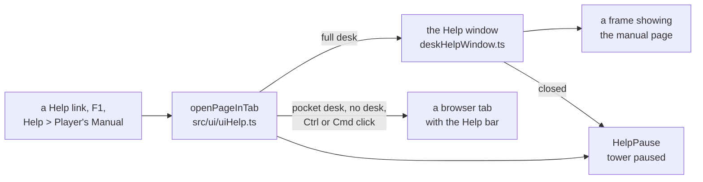
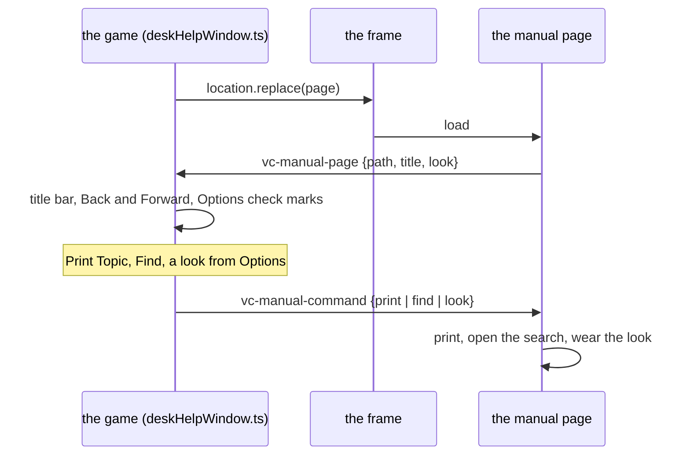

# The Help window

On the full desk (a computer, or a touchscreen at least 1024 by 600) the
Player's Manual opens in a desk window of its own instead of a browser tab:
Help > Player's Manual, F1 and every Help link in the game show their page in
it. The pocket desk and the game without a desk keep the browser tab, and the
[Help bar](./help-bar.md) still works there. This page records how the game
and a manual page inside the window talk. The window's size, buttons and
where it opens are in [desk-windows.md](../ui/desk-windows.md).

## The parts

| Part | File | Runs on |
| --- | --- | --- |
| The window: title bar, menu bar, Contents, Back, Forward, Open in Browser, a frame | `buildHelpWindow` in `@verticopolis/components/windows/desk/deskHelp` | the game |
| The game's side: which page shows, Back and Forward, the menus' commands | `src/ui/desk/deskHelpWindow.ts`, `src/ui/desk/deskHelpMenu.ts` | the game |
| Where a Help link goes | `openPageInTab` in `src/ui/uiHelp.ts` | the game |
| The words they trade | `src/manual/manualEmbed.ts` | both |
| The manual's side | `help-site/src/components/Head.astro`, `Header.astro`, `HelpBar.astro` | the manual page |
| The pause | `HelpPause.hold` in `src/ui/helpPause.ts` | the game |
| The manual offline | `src/manual/manualWorker.ts`, `src/manual/manualOffline.ts` | both |

## One page in the frame

The manual's host lets only the game frame it (`frame-ancestors` in
`vercel.json`: the game's host for help.verticopolis.com, and `'self'` for a
manual served under `/help` on the game's own host), so a manual page that
finds itself in a frame is inside the game. It then wears the `vc-embedded`
class, which hides what the window already has (the manual's menu bar, its
game button and the Help bar), follows its own links with
`location.replace` so the game's history never fills with manual pages,
opens links that leave the manual in a browser tab, and tells the game each
page it shows.

Messages go to one origin and are read from one: the game's
(`gameOriginFor`) and the manual's (`helpUrl`). The page message names the
page's look, so the window's Options menu can check it. Back and Forward are
the game's own list, built from the page messages, and move the frame with
`location.replace` too.

## The pause

Help never costs the player elevator time. Opening the window holds the
tower's pause (`HelpPause.hold`) until the window closes. A Help dialog or a
tab that opens and closes meanwhile leaves the tower paused, and the speed
the player had comes back when the last of them is done
(`src/ui/helpPause.ts` has the rules).

## Offline

The manual's pages register their own service worker
(`src/manual/manualWorker.ts`), which saves the manual. Once it has, the
pages set the `vc_manual` cookie to the manual's host. The game reads that
cookie before it opens Help offline (`src/manual/manualOffline.ts`): with the
manual saved it opens the page as usual and the worker answers it; without,
it says the manual needs the internet. The cookie names the host, so the
production manual's cookie never tells a staging game that its own `/help`
copy is saved. The game's own service worker still never precaches the
manual.

## Tests

`manualEmbed`, `manualOffline`, `manualWorker`, `deskHelpWindow`,
`deskHelpMenu` and `helpPause` have unit tests beside their files. The
components' gallery runs the window over a sample manual
(`e2e/desk.spec.ts` there), and the game's screenshot gallery has the
`desk-help` shard, which frames the real Player's Manual.
